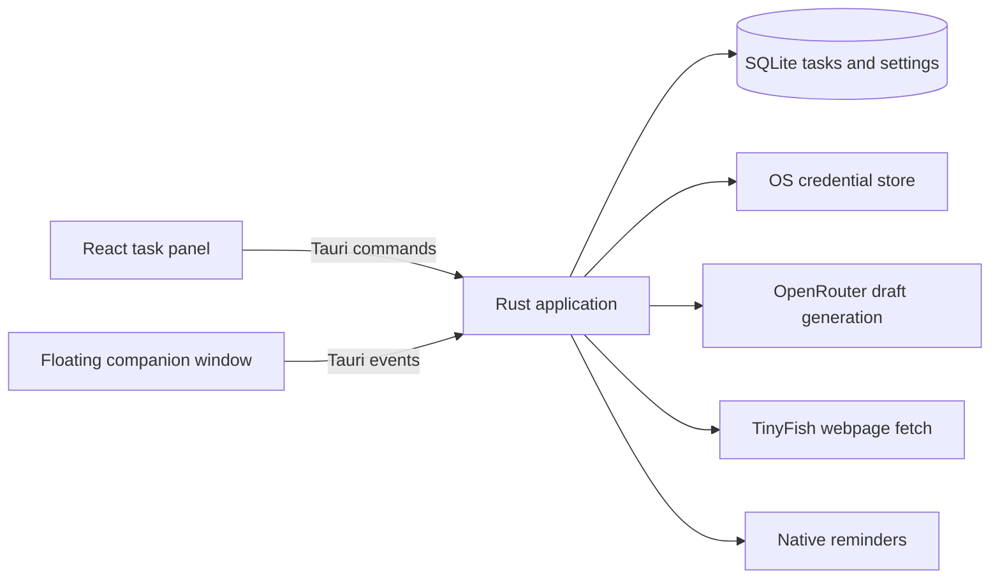

# Moonie

Moonie is a calm desktop task companion for macOS and Windows. Capture a thought or paste a public webpage URL, review editable task drafts, and let Moonie suggest one next action. It is built with Tauri 2, Rust, React, TypeScript, Vite, and SQLite.

## Current state

The local task system, AI draft review, TinyFish adapter, tray, shortcut, floating companion, and macOS packaging are implemented. The current companion uses original generated artwork with subtle CSS motion. **It is not a Live2D Cubism model.** The [custom separated art and Cubism rig](docs/live2d-production.md), Web SDK integration, Cubism Viewer validation, and native Windows smoke test remain before the complete MVP in the [project plan](docs/plan.md). This is a working desktop preview; the final animated-mascot release is pending that production work.

API integrations require your own OpenRouter and TinyFish keys. They have not been exercised end to end without credentials. Keys are stored in the OS credential store through Rust; approved tasks and preferences are in SQLite. Drafts are kept in memory until approval.

## Included workflows

- Manual tasks with notes, deadlines, schedules, duration estimates, prerequisites, completion, snoozing, deletion, and daily/weekly recurrence.
- Editable AI drafts with transactional, idempotent batch approval, explicit cancellation, preserved input on errors, and sourced webpage extraction.
- Deterministic next-task suggestions, persistent focus sessions, quiet mode, native reminders, tray controls, configurable shortcut, and remembered mascot position.
- Bundled fonts and an original Moonie visual preview with animation pause/reduced-motion settings.

## Run locally

1. Install Node.js 22.12+, pnpm 10+, Rust 1.99+, and [Tauri platform prerequisites](https://v2.tauri.app/start/prerequisites/).
2. Run `cd app && pnpm install && pnpm tauri dev`.
3. In Settings, save an OpenRouter key, load the model list, select a structured-output capable model, and optionally save a TinyFish key for webpage capture.
4. Manual tasks work without keys or network access.

Build: `cd app && pnpm tauri build`. The desktop shortcut is Command+Shift+Space on macOS and Ctrl+Shift+Space on Windows. Closing the panel leaves the tray app and reminders running; use the tray's Quit action to stop it.

## Architecture

The [project plan](docs/plan.md) specifies Live2D Cubism for the final mascot; the current image is a placeholder until that rig is produced and integrated. No FastAPI server or local HTTP port is used.

## Verification

`pnpm build`, `pnpm format:check`, `cargo test`, and `cargo clippy --all-targets -- -D warnings` pass locally. Six Rust tests cover dependencies, next-task selection, recurrence, database migration, and reminder time zones/delivery tracking. The CI workflow builds macOS and Windows packages and uploads installers as build artifacts. Native UI, notifications, shortcut conflicts, multi-monitor behavior, and AI integrations still need platform smoke tests.

## Artwork and licensing

`app/public/moonie.png` was generated for this project from the supplied character reference. The Live2D Cubism SDK and proprietary Core are not included. Review [Live2D's SDK licensing](https://www.live2d.com/en/sdk/license/) before distributing a future rigged build.
